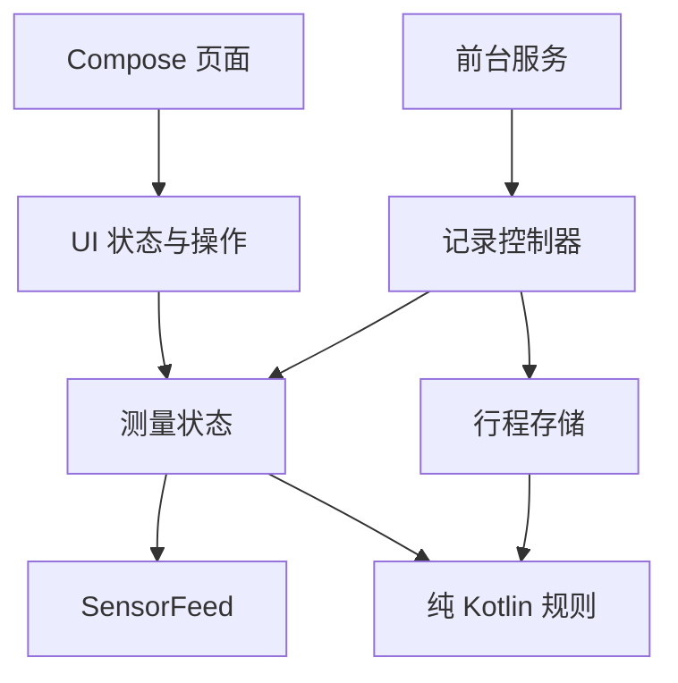

# 架构与测量约定

## 边界

`core` 处理可独立验证的数学和业务规则；`app` 处理平台 I/O 与交互。保持两个 Gradle 模块：当前规模不需要为每一页面拆独立模块，也不引入只有转发作用的 UseCase 类。

`AppContainer` 是唯一组装点，向 ViewModel 和前台服务提供应用级对象。没有反射 DI，没有 Activity 持有传感器，也没有 ViewModel 绑定后台服务。`SensorFeed` 是有替换价值的平台边界，业务不认识 `SensorManager` 或 `LocationManager`。

## 测量

- 位置时间使用 `elapsedRealtimeNanos`，与单调时钟比较，避免系统时间变化破坏新鲜度判断。
- 仅请求原生 GNSS。不会把无高度的定位变成 0 米，不把水平精度作为垂直精度，也不采用无限期 last-known 缓存。
- Android 14+ 使用系统 `AltitudeConverter`，放在 I/O dispatcher；转换失败保留显式的椭球高度。
- 气压滤波按事件时间间隔计算系数，避免不同传感器频率改变平滑程度。注册回调与清理成对，订阅结束释放硬件。
- 自动模式依次选择有效校准气压、有效卫星、相对气压，不对不同基准做加权平均。
- 校准通过已知高度反解参考海平面气压；校准值、时间存入 DataStore。12 小时仅是产品失效策略，不是准确性保证。
- 相对零点在应用进程内保留，界面旋转、权限刷新和前后台切换不会改变已有零点；进程重启创建新相对测量。

## 生命周期与记录

`MeasurementRepository.state` 通过 `WhileSubscribed` 管理硬件。UI 使用 `collectAsStateWithLifecycle`；后台记录持有自己的订阅，所以界面停止不会使测量停止。无 UI、无记录订阅时自动释放。

`RecordingController` 串行处理开始/结束命令，每个行程只有一个写入者。记录间隔和数据源/基准在开始时固定。源失效就留空，通知提示等待恢复；不把另一个高度系插进去。

`RecordingService` 只负责 Android 服务、通知和有时限的唤醒锁；只由可见 Activity 发起，不申请后台位置权限，不自启动，不在进程恢复时偷偷续录。通知提供明确的结束操作。用户主动记录时保持 CPU 唤醒以支持非 wake-up 气压计，结束后释放，因此长时间记录会耗电。

行程时长使用单调时钟，日期标签使用墙上时钟；修改系统时间不会改变已记录的持续时间。

一条采样和对应行程摘要在同一 Room 事务中提交。恢复时未结束行程依据最后成功落盘的采样时间标为中断。不要用破坏性数据库迁移；后续 schema 变更必须增加版本和显式 Migration。

## 数据与图表

原始采样始终使用米、hPa、UTC 毫秒与单调时间。每个点保存来源、高度基准、参考标识、可选垂直精度、可选坐标和模拟位置标记。

- 累计爬升采用死区阈值，低精度卫星不计爬升；超长间断、来源/基准改变和不合理跳变不连算。
- CSV、GPX 每批读取 1000 点，避免把整段长记录加载到内存。
- 历史图预览按桶保留首尾和极值，保留真实间断；图表抽样不改变原始记录或导出。
- GPX `<ele>` 仅使用海平面高度。椭球/相对高度进入命名空间扩展；缺坐标的点不伪造坐标。
- 数据由系统文件选择器导出，无共享外部存储权限，无世界可读目录。

## 有意不引入

Google Play Services、网络地形服务、地图 SDK、账号同步、通用事件总线、Hilt、跨平台 UI 和第三方图表库。现阶段它们会增加设备依赖或维护成本，而非改善高度测量。原生 Compose Canvas 足以绘制当前图表。

## 平台参考

- [Android Location：高度与垂直精度](https://developer.android.com/reference/android/location/Location)
- [系统 AltitudeConverter](https://developer.android.com/reference/android/location/altitude/AltitudeConverter)
- [位置前台服务的权限与生命周期要求](https://developer.android.com/develop/background-work/services/fgs/service-types#location)
